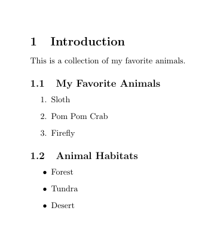

:::::::::::::::::::::::::::::::::::::: questions

- How can I organize data in my document within sections?

::::::::::::::::::::::::::::::::::::::::::::::::

::::::::::::::::::::::::::::::::::::: objectives

- Create a list within a LaTeX document.
- Experiment creating different kinds of lists.
- Customize the appearance a list.

::::::::::::::::::::::::::::::::::::::::::::::::

## Lists

In LaTeX, as in markdown, there are two types of lists: ordered and unordered. They are both
defined with `\begin{...}` and `\end{...}` commands, as we saw with the document body. Let's add
an ordered list to our document.

```latex
\documentclass{article}

\begin{document}
	\section{Introduction}
	This is a collection of my favorite animals.

	\subsection{My Favorite Animals}

	\begin{enumerate}
		\item Sloth
		\item Pom Pom Crab
		\item Firefly
	\end{enumerate}

	\subsection{Animal Habitats}

	\begin{itemize}
		\item Forest
		\item Tundra
		\item Desert
	\end{itemize}

\end{document}
```

When you compile this document, you should see something like this in the preview pane:

{alt='Our document with both an enumerated list and an itemized list.'}

::: callout

Note that the `\item` commands do not need to be enclosed in braces. These commands do not take
any arguments, so they can be used as standalone commands. The text that follows the `\item`
command will be treated as the content of the list item. However, you are able to specify your own
bullet point symbols with `\item[]` manually:

```latex
\begin{itemize}
  \item[(1)] Forest
  \item[A!] Tundra
  \item[4.] Desert
\end{itemize}
```

It's generally reccomended to let LaTeX number things for you.
If you have a specific appearance (e.g. roman numerals) there are packages that can do that for you.

:::

::: callout

It's possible to create a list with roman numerals automatically with the `enumitem` package:
```latex
\documentclass{article}
\usepackage{enumitem} %<-- package for lists https://texdoc.org/serve/enumitem/
% \setlist{label=\Roman*} %<-- globally defining the enumeration system
\begin{document}
\begin{enumerate}[
  label=\emph{\roman*}, %<-- change labeling system locally (or \Roman)
  leftmargin=5cm, %<-- change indent on the left
]
  \item First
  \item Second
  \item Third
  \item Fourth
\end{enumerate}
\end{document}
```

:::

There's also a sort of list called a "description".
It functions the same way as the others, but just has a slightly different format, handy for making definitions:

```latex
\begin{description}
  \item[Insects] Have a exoskeleton
  \item[Mammals] Hairy and warm blooded
  \item[Fish] There's no such thing
\end{description}

```

### Nesting Lists

We can create a list within a list by nesting one environment inside another. For example:

```latex
\begin{itemize}
  \item Forest

  \begin{enumerate}
    \item Tropical
    \item Temperate
  \end{enumerate}

  \item Tundra
  \item Desert
\end{itemize}
```


## Challenges

::::::::::::::::::::::::::::::::::::: challenge

## Challenge: What needs to change?

We have the following in our LaTeX document:

```latex
\documentclass{article}

\begin{document}

\begin{enumerate}
  \item Banana Bread
  \item Carrot Muffins
  \item Apple Cake
\end{enumerate}

\end{document}
```

How would we modify this to change this ordered list to an unordered list?

:::::::::::::::::::::::: solution

## Answer

You would need to change the `enumerate` environment to `itemize`:

```latex
\documentclass{article}

\begin{document}

\begin{itemize}
  \item Banana Bread
  \item Carrot Muffins
  \item Apple Cake
\end{itemize}

\end{document}
```

:::::::::::::::::::::::::::::::::
::::::::::::::::::::::::::::::::::::::::::::::::

::::::::::::::::::::::::::::::::::::: challenge

## Challenge: What's wrong here?

We have the following in our LaTeX document:

```latex
\documentclass{article}

\begin{document}

\enumerate{list}
\item{"Apples"}
\item{"Bananas"}
\item{"Carrots"}
\enumerate{list}

\end{document}
```

How would we modify this to change this ordered list to an unordered list?

:::::::::::::::::::::::: solution

## Answer

There's two issues here:

1. There is no `enumerate` command (the thing that starts with a slash). We need to use an `enumerate` environment instead, which starts with `\begin{enumerate}` and ends with `\end{enumerate}`.
2. We don't need to surround the items with parentheses or put them in quotes.

That there isn't any indentation is not actually an error - in LaTeX (almost!) all whitespace is ignored.

:::::::::::::::::::::::::::::::::
::::::::::::::::::::::::::::::::::::::::::::::::

::::::::::::::::::::::::::::::::::::: challenge

## Challenge: Can you do it?

We would like to have the following appear in our LaTeX document:

- Apples
  1. Gala
  2. Fuji
  3. Granny Smith
- Bananas
- Oranges

How would you write this in LaTeX?

:::::::::::::::::::::::: solution

## Answer

```latex
\documentclass{article}

\begin{document}

\begin{itemize}
  \item Apples
  \begin{enumerate}
    \item Gala
    \item Fuji
    \item Granny Smith
  \end{enumerate}
  \item Bananas
  \item Oranges
\end{itemize}

\end{document}
```

:::::::::::::::::::::::::::::::::
::::::::::::::::::::::::::::::::::::::::::::::::

::::::::::::::::::::::::::::::::::::: challenge


## Challenge: Enumerate your list manually

We would like to have the following appear in our LaTeX document:


1. Gala
2. Fuji
3. Granny Smith


How would you write this in LaTeX **without** using `enumerate` but `itemize` with `\item[]`?

:::::::::::::::::::::::: solution

## Answer

```latex
\documentclass{article}

\begin{document}

\begin{itemize}
  \item[1.] Gala
  \item[2.] Fuji
  \item[3.] Granny Smith
\end{itemize}

\end{document}
```

:::::::::::::::::::::::::::::::::
::::::::::::::::::::::::::::::::::::::::::::::::

::::::::::::::::::::::::::::::::::::: keypoints

- Lists in LaTeX can be created using `itemize` for unordered lists and `enumerate` for ordered lists.
- You can add elements to the lists with the `\item` command.
- Although not strictly necessary, you can manually enumerate items using `\item[]` with a custom label.

::::::::::::::::::::::::::::::::::::::::::::::::
