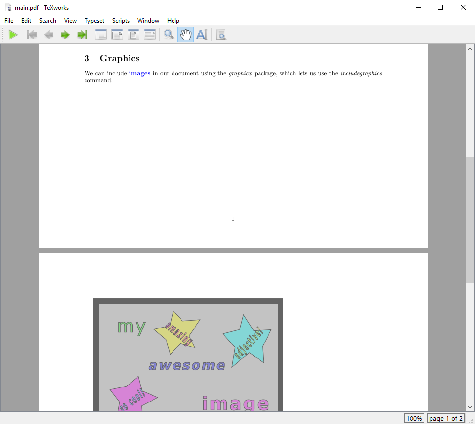
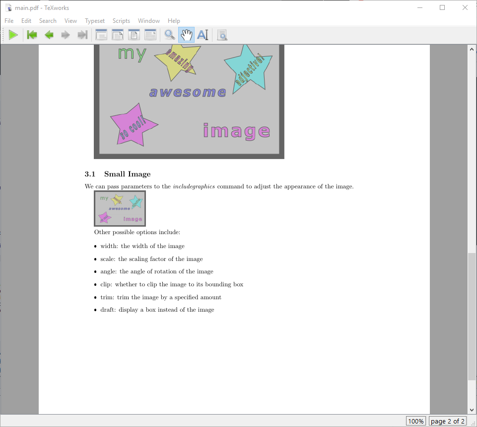
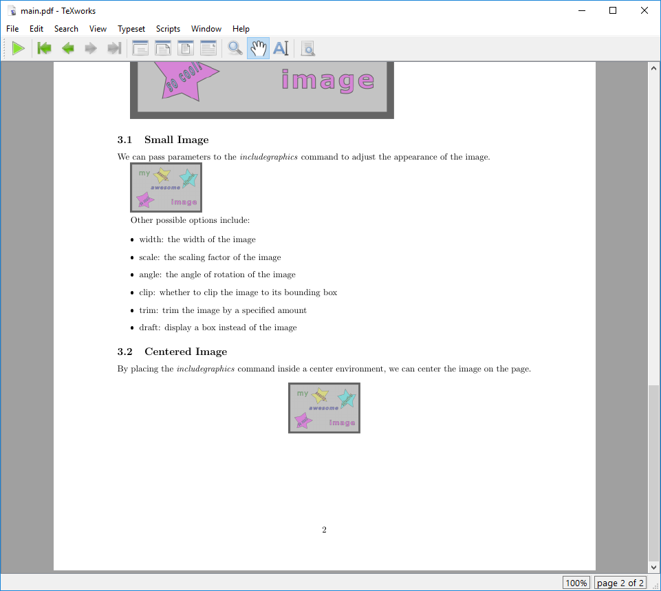
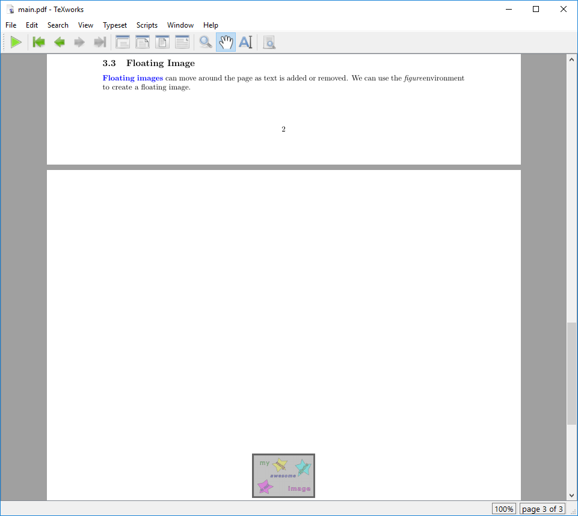
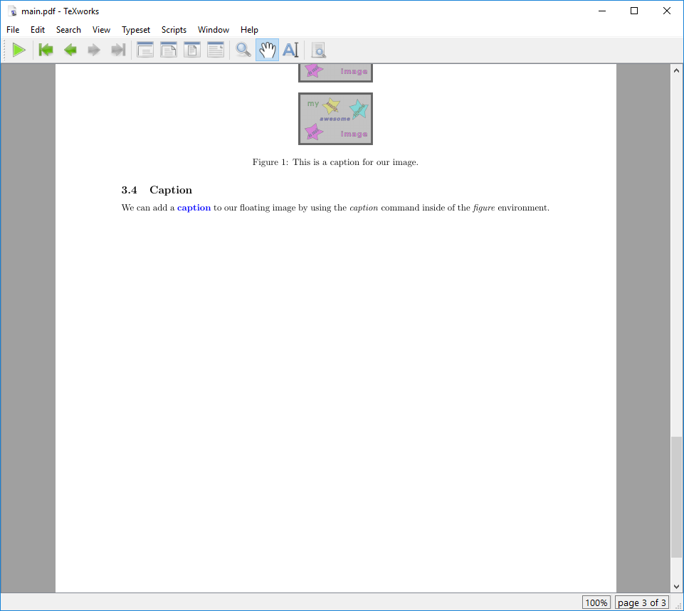

:::::::::::::::::::::::::::::::::::::: questions

- How do I include images in a LaTeX document?

::::::::::::::::::::::::::::::::::::::::::::::::

::::::::::::::::::::::::::::::::::::: objectives

- Demonstrate how to include images in a LaTeX document.
- Show how to position images manually / automatically in a LaTeX document.

::::::::::::::::::::::::::::::::::::::::::::::::

## The Graphicx Package

In order to use graphics in our document, we'll need to use the `graphicx` package, which adds the
`\includegraphics` command to LaTeX. We'll add this to the preamble of our document:

```latex
\usepackage{graphicx}
```

We can now include several types of images in our document, including:

- JPEG
- PNG
- SVG
- PDF
- EPS

::: callout

Although LaTeX can handle several commonly used image formats, there are a few which are currently
incompatible with LaTeX. For example, the `webp` and `tiff` formats. If you have an image in one
of these formats, you will need to convert it to a compatible format before including it in your
document.

:::

For the purposes of this lesson, we'll use the following image:

{alt='Our example image.'}

::: callout

Download this image to your computer either be right-clicking on the image and selecting "Save
Image As..." or by clicking on the image and saving it from the browser.

You can use any image you like for this lesson. Just make sure to replace `my-awesome-image.png` with
the name of your image in the following examples.

:::

Place the image in the same directory as your LaTeX document so that LaTeX can find it when we
compile the document.

## Including an Image in a LaTeX Document

Now that we have our image, we can include it in our document using the `\includegraphics`
command:

```latex
\documentclass{article}

\usepackage{graphicx}

\begin{document}

My Amazing Image:

\includegraphics{my-awesome-image}

\end{document}
```

Your document should now look like this:

{alt='Our document with an included image.'}

::: callout

If you just want to see how an image might look in your document without having to find one, you
can use the filepath `example-image` in the `\includegraphics` command. This will display a
placeholder image in your document that you can replace later.

:::

### Adjusting the appearance of the image

But wait! The image is too big, and it doesn't fit on the page, so LaTeX has moved it to the next
page. Since the image is a little too large to fit on the same page as the text, LaTeX has moved it
automatically to the next page. Let's address that by making the image smaller.

We can adjust the appearance of the image by passing options to the `\includegraphics` command, just
like we did earlier with the `geometry` package. For example, we can specify the height of the
image:

```latex
\documentclass{article}

\usepackage{graphicx}

\begin{document}

My Amazing Image:

\includegraphics{my-awesome-image}

\subsection{Image Options}

\begin{itemize}
  \item height
  \item width
  \item scale
  \item angle
\end{itemize}

A smaller image:

\includegraphics[height=2cm]{my-awesome-image}

\end{document}

```

{alt='Our document with a smaller image.'}

::: callout

Some other possible options from the `graphicx` package include:

- `width`: the width of the image
- `scale`: the scaling factor of the image
- `angle`: the angle of rotation of the image
- `clip`: whether to clip the image to its bounding box
- `trim`: trim the image by a specified amount
- `draft`: display a box instead of the image

:::

### Positioning the image

We can place the image inside of an environment to help position it in the document. Let's try
placing the `\includegraphics` command inside of a `\begin{center}` and `\end{center}` environment:

```latex
\subsection{Centered Image}

\begin{center}
  \includegraphics[height=2cm]{my-awesome-image}
\end{center}
```

You should see that the image is now centered on the page:

{alt='Our document with a centered image.'}

::: callout

The `center` environment is not specific to images, and can be used to center any content within the document.

:::

## "Floating" Images

It's often the case that images need to "float" around the document as new text is added or removed.
this is called a "floating" image. Images are normally included as floats so that we don't end up
with large gaps in the document.

To make an image float, we can use the `figure` environment:

```latex
\subsection{Floating Image}

\begin{figure}
  \centering
  \includegraphics[height=2cm]{my-awesome-image}
\end{figure}
```

When we render the document, we can see that, even though we placed the image at the end of the
document, it appears at the top of the page:

{alt='Our document with a floating image.'}

::: callout

You might have noticed that instead of using the `\begin{center}` and `\end{center}` environment,
we used the `\centering` command inside of the `figure` environment. This is because the `figure`
environment is a floating environment, and the `\centering` command is the recommended way to
center content inside of a floating environment.

:::

### Controlling the Position of a Floating Image

We can pass parameters to the `figure` environment to control the position of the floating image:

- `h`: Place the float "here" (where it appears in the code)
- `t`: Place the float at the "top" of the page
- `b`: Place the float at the "bottom" of the page
- `p`: Place the float on a "page" by itself

It is also possible to combine these options. For example, to place the float here if possible, but
otherwise at the top of the page, we can use the `ht` option. Let's update our `figure` environment
to use the `ht` option:

```latex
\begin{figure}[ht]
  \centering
  \includegraphics[height=2cm]{my-awesome-image}
\end{figure}
```

::: callout

You can use the package `wrapfig` together with `graphicx` in your preamble.
This makes the `wrapfigure` environment available and we can place an `\includegraphics` command
inside it to create a figure around which text will be wrapped. Here is how we can specify a
`wrapfigure` environment:

```latex
\begin{wrapfigure}[lineheight]{position}{width}
  ...
\end{wrapfigure}
```

We will describe the `wrapfigure` environment in more detail in one of the challenges below.
:::


### Adding a Caption

We can add a caption to our image by using the `\caption` command inside of the `figure`
environment:

```latex
\subsection{Caption}

\begin{figure}[h]
  \centering
  \includegraphics[height=2cm]{my-awesome-image}
  \caption{This is a caption for our image.}
\end{figure}
```

When we render the document, we can see that the caption appears below the image:

{alt='Our document with a floating image.'}

::: callout

Note that the caption is automatically numbered "Figure 1". Very handy! We'll see how we can
automatically reference figures and tables in a later episode.

:::

::: spoiler

Another package that we can use to work with images in LaTeX is the `hvfloat` package. This package
is an alterantive way of controlling the position of floating elemnents in LaTeX, like images
and tables. It provides a more flexible way of positioning floats allowing us to, for example,
place a float at the bottom of the page, even if there is not enough space for it to fit.

:::

## Challenges

::::::::::::::::::::::::::::::::::::: challenge

## Challenge 1: Can you do it?

Consider again our running example of `my-awesome-image`.
Start a new document from scratch, and include this image into your LaTeX document by using the `figure` environment.
Make sure that your image is centered and rotate the image by 45 degrees.
Add the following caption to your image: "This caption has a **bold** word included."
What would your LaTeX look like?

:::::::::::::::::::::::: solution

## Output

We use the `\centering` command in the `figure` environment and specify `angle=45` to rotate the
image.

```latex
\documentclass{article}

\usepackage{graphicx}

\begin{document}

\begin{figure}
  \centering
  \includegraphics[angle=45]{my-awesome-image}
  \caption{This caption has a \textbf{bold} word included.}
\end{figure}

\end{document}
```

:::::::::::::::::::::::::::::::::
::::::::::::::::::::::::::::::::::::::::::::::::


::::::::::::::::::::::::::::::::::::: challenge


## Challenge 2: What is wrong here?

Have a look at the following LaTeX code:

```latex
\documentclass{article}

\begin{document}

\centering
\begin{figure}
  \includegraphics[height=3cm, draft]{my-awesome-image}
  \caption{This caption has a \textbf{bold} word included.}
\end{figure}

\end{document}
```

Can you spot all the errors in this LaTeX code?
Change the code such that the image is displayed with a height of 3cm, width of 4cm and centered.


:::::::::::::::::::::::: solution

1. the command `\usepackage{graphicx}` is missing in the preamble.
2. the `\centering` command has to be placed into the `figure` environment.
3. the `draft` argument has to be removed from the `\includegraphics` command and `width=4cm` added.

The corrected LaTeX code looks like this:

```latex
\documentclass{article}

\usepackage{graphicx}

\begin{document}

\begin{figure}
  \centering
  \includegraphics[height=3cm, width=4cm]{my-awesome-image}
  \caption{This caption has a \textbf{bold} word included.}
\end{figure}

\end{document}
```


:::::::::::::::::::::::::::::::::
::::::::::::::::::::::::::::::::::::::::::::::::


::::::::::::::::::::::::::::::::::::: challenge

## Challenge 3: Making a command for images

In the previous section, we created a command to highlight keywords in our document. Let's create
a new command to make it easier to include images in our document. We'll create a command called
`\centeredimage` that takes two arguments: the image filename and the caption. The resulting image
should be centered on the page and have a caption below it. Use the example-image.png from earlier
in this episode.

Your file should look like this:

```latex
\documentclass{article}
\usepackage{graphicx}

% Define our new command
%%% YOUR COMMAND HERE %%%

\begin{document}

\centeredimage{example-image.png}{"My Image"}
\centeredimage{example-image.png}{"My Other Image"}

\end{document}
```

And your output should look [like this](fig/06-using-graphics/challenge-image-command-output.PNG).

Reminder: The syntax for creating a new command is:

```latex
\newcommand{\cmdname}[numargs]{definition}
```

::: hint

Some code to get you started:

```latex
\newcommand{\centeredimage}[2]{
  \begin{???}
    \centering
    ???
    ???
  \end{???}
}
```

:::

:::::::::::::::::::::::: solution

```latex
\documentclass{article}
\usepackage{graphicx}

% Define our new command
\newcommand{\centeredimage}[2]{
  \begin{figure}
    \centering
    \includegraphics{#1}
    \caption{#2}
  \end{figure}
}

\begin{document}

\centeredimage{my-awesome-image}{"My Image"}
\centeredimage{my-awesome-image}{"My Other Image"}

\end{document}
```

:::::::::::::::::::::::::::::::::
::::::::::::::::::::::::::::::::::::::::::::::::

::::::::::::::::::::::::::::::::::::: challenge


## Challenge 4: The `wrapfig` package.


Have a look at the following LaTeX code that uses the `wrapfigure` environment.

- Can you already guess how the images will be displayed in your document?
- Try adjusting the values for the width and placement of the images to see how it affects their appearance in the document.
- Why might we want to use `\textwidth` when specifying the width of an image?


```latex
\documentclass{article}

\usepackage{graphicx}
\usepackage{lipsum}
\usepackage{wrapfig}

\begin{document}

  \lipsum[1]

  \begin{wrapfigure}{r}{3cm}
    \centering
    \includegraphics[width=3cm]{my-awesome-image}
  \end{wrapfigure}

  \lipsum[2-3]

  \begin{wrapfigure}{l}{0.2\textwidth}
    \centering
    \includegraphics[width=0.2\textwidth]{example-image}
  \end{wrapfigure}

  \lipsum[4]

\end{document}
```

:::::::::::::::::::::::: solution

The `wrapfigure` environment allows us to wrap text around an image.
The first argument specifies the placement of the image (`r` for right, `l` for left), while the second argument specifies the width of the image.
The `includegraphics` command is the same one we've used before and we are specifying the width of the image using either absolute units like `cm` or relative units like `\textwidth`.
Using `\textwidth` allows the image to scale relative to the width of the text, which can be useful for maintaining consistent proportions in different document layouts.

:::::::::::::::::::::::::::::::::
::::::::::::::::::::::::::::::::::::::::::::::::


::::::::::::::::::::::::::::::::::::: keypoints

- The `graphicx` package allows us to include images in our LaTeX document.
- We can adjust the appearance of images using options in the `\includegraphics` command.
- We can position images manually or automatically using environments like `center` and `figure`.
- Floating images can move around the page as text is added or removed.
- We can control the position of floating images using parameters in the `figure` environment.
- We can add captions to floating images using the `\caption` command.

::::::::::::::::::::::::::::::::::::::::::::::::
