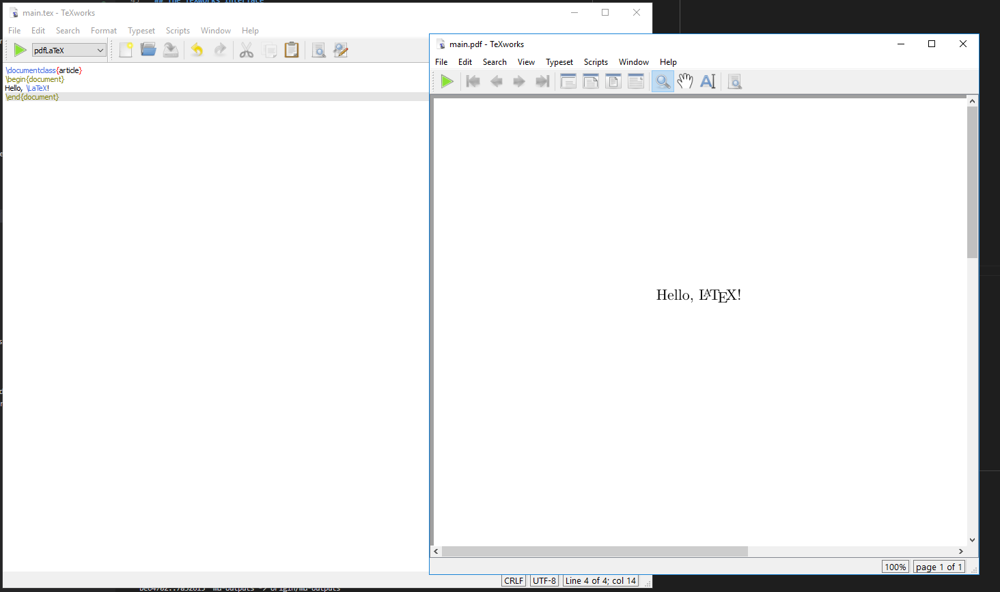
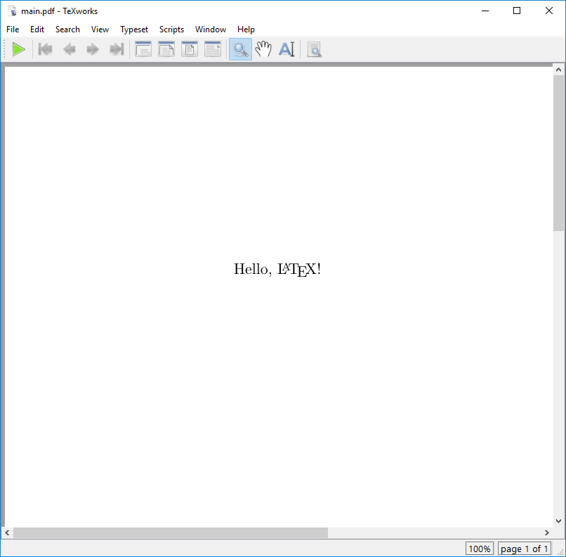

:::::::::::::::::::::::::::::::::::::: questions

- What do I need to do to write and edit a LaTeX document?
- How can I render a LaTeX document?

::::::::::::::::::::::::::::::::::::::::::::::::

::::::::::::::::::::::::::::::::::::: objectives

- Demonstrate how to create a new LaTeX Document.
- Become familiar with the editor interface.
- Compile a LaTeX document with the editor.
- Compile a LaTeX document with the command line.

::::::::::::::::::::::::::::::::::::::::::::::::

## What is LaTeX

LaTeX is a typesetting language, useful for combining text with mathematical equations, figures,
tables, and citations, among other things.

Unlike common word processors like Microsoft Word or LibreOffice Writer, LaTex is a *markup
language*, meaning that formatting (including bold text, bullet points, and changes in font size)
is indicated by the use of commands, special characters, or *environments*.

In order to produce the actual document, this mark-up text must be *compiled*. Errors in the
mark-up can either be non-fatal, meaning the document will compile with some warnings; or fatal,
meaning the document will fail to compile.

## Our First LaTeX Document

To begin with, we will create a new directory to hold our files for this workshop. Call it
`latex-workshop`, and make a note of the path to this directory.

Start the TeXworks editor and immediately "save" the file. This will prompt you for a location to
save the file, so navigate to the `latex-workshop` directory you just created, and save the file
as `main.tex`.

## The Interface

::: tab

## TeXStudio

The TeXStudio interface is divided into several sections:

1. The **Editor**: This is where you write your LaTeX code. It supports syntax highlighting and
   basic code completion.

2. The **Preview Pane**: This shows the compiled output of your LaTeX code. This window will appear
   whenever we compile the document.

3. The **Menu Bar**: This contains various options for managing your document, such as saving,
   compiling, and printing. You can also access the preferences and settings from here.

4. The **Toolbar**: This contains buttons for common actions, such as saving, compiling, and
   inserting common LaTeX commands.

5. The **Message Window**: This shows information about the results from the most recent attempt at
   compilation. Any errors encountered will be displayed here.

{alt='An image of the TeXStudio interface, showing the locations of the main UI elements.}

## TeXworks

The TeXworks interface is divided into three main sections:

1. The **Editor**: This is where you write your LaTeX code. It supports syntax highlighting and
   basic code completion.

2. The **Preview Pane**: This shows the compiled output of your LaTeX code. This window will appear
   whenever we compile the document.

3. The **Menu Bar**: This contains various options for managing your document, such as saving,
   compiling, and printing. You can also access the preferences and settings from here.

The overall interface is designed to be simple and intuitive, focusing on the essential features
of a LaTeX editor. Note the large green triangle button in the top left corner of the interface.
This is the "Typeset" button, which compiles your LaTeX document and updates the preview pane with
the rendered output. Next to the "Typeset" button is a drop-down menu that allows you to select
the typesetting engine you wish to use. For this workshop, we will use the default engine,
PDFLaTeX.

{alt='An image of the TeXWorks editor, showing the locations of the main UI elements.'}

:::

## Compiling a LaTeX Document

Type the following code into the editor:

```latex
\documentclass{article}
\begin{document}
Hello, \LaTeX!
\end{document}
```


::: tab

## TeXStudio

Now click the green double arrow icon on the toolbar (or press "F5" on your keyboard). This will
compile the document and update the preview pane with the rendered output. You should see a PDF
preview of the document with the text "Hello, LaTeX!".

## TeXworks

Now click the green "Typeset" button in the top left corner of the interface. This will compile
the document and update the preview pane with the rendered output. You should see a PDF preview
of the document with the text "Hello, LaTeX!".

{alt='The TeXStudio editor with the preview pane showing the results of our first document.'}

:::


When you click the "Typeset" button, the editor will run the LaTeX compiler on your document. You
will see a window appear on the bottom of the interface called "Console output". This window
contains the output of the compiler, including any warnings or errors that may have occurred
during the compilation process. We will talk about this in more detail in a later episode.


## Compiling a LaTeX Document from the Command Line

Using an IDE like TeXStudio or TeXworks is a convenient way to write and compile LaTeX documents,
but you are not limited to using it. Any program that can edit text files can be used to write
LaTeX, which we can then compile from the command line.

You can use any text editor to write your LaTeX code. Some popular text editors for LaTeX include:

- [Visual Studio Code](https://code.visualstudio.com/)
- [Emacs](https://www.gnu.org/software/emacs/)
- [Vim](https://www.vim.org/)
- Notepad++ (Windows only)

We will continue to demonstrate with TeXworks, but you can use any text editor you prefer.

To compile a LaTeX document from the command line, you can use the `pdflatex` command. Open a
console or terminal window, then navigate to the directory where you saved your `main.tex` file.

::: spoiler

Useful commands for navigating the command line:

- `cd <directory>`: Change directory to `<directory>`.
- `ls` (Linux/macOS) or `dir` (Windows): List the files in the current
  directory.
- `pwd` (Linux/macOS): Print the current working directory.

:::

Once you are in the correct directory, run the following command:

```bash
pdflatex main.tex
```

You should see output similar to the following:

```
This is pdfTeX, Version 3.141592653-2.6-1.40.28 (TeX Live 2025) (preloaded format=pdflatex)
 restricted \write18 enabled.
entering extended mode
(./main.tex
LaTeX2e <2024-11-01> patch level 2
L3 programming layer <2025-04-29>
(e:/texlive/2025/texmf-dist/tex/latex/base/article.cls
Document Class: article 2024/06/29 v1.4n Standard LaTeX document class
(e:/texlive/2025/texmf-dist/tex/latex/base/size10.clo))
(e:/texlive/2025/texmf-dist/tex/latex/l3backend/l3backend-pdftex.def)
(./main.aux)
[1{e:/texlive/2025/texmf-var/fonts/map/pdftex/updmap/pdftex.map}] (./main.aux)
)<e:/texlive/2025/texmf-dist/fonts/type1/public/amsfonts/cm/cmr10.pfb><e:/texli
ve/2025/texmf-dist/fonts/type1/public/amsfonts/cm/cmr7.pfb>
Output written on main.pdf (1 page, 21048 bytes).
Transcript written on main.log.
```

You can also use the compiler LuaLaTeX which is more powerful but can take a
little bit longer to generate pdfs.

```bash
lualatex main.tex
```

The output is this:

```
This is LuaHBTeX, Version 1.22.0 (TeX Live 2025)
 restricted system commands enabled.
(./main.tex
LaTeX2e <2025-06-01> patch level 1
L3 programming layer <2025-07-11>
 (/usr/local/texlive/2025/texmf-dist/tex/latex/base/article.cls
Document Class: article 2025/01/22 v1.4n Standard LaTeX document class
(/usr/local/texlive/2025/texmf-dist/tex/latex/base/size10.clo))
(/usr/local/texlive/2025/texmf-dist/tex/latex/l3backend/l3backend-luatex.def)
No file main.aux.

[1{/usr/local/texlive/2025/texmf-var/fonts/map/pdftex/updmap/pdftex.map}]
(./main.aux))
 406 words of node memory still in use:
   3 hlist, 1 vlist, 1 rule, 2 glue, 3 kern, 1 glyph, 4 attribute, 48 glue_spec
, 4 attribute_list, 1 write nodes
   avail lists: 2:38,3:4,4:1,5:26,6:2,7:56,9:24
</usr/local/texlive/2025/texmf-dist/fonts/opentype/public/lm/lmroman7-regular.o
tf></usr/local/texlive/2025/texmf-dist/fonts/opentype/public/lm/lmroman10-regul
ar.otf>
Output written on main.pdf (1 page, 4850 bytes).
Transcript written on main.log.
```

Notice how the size of the pdf is about one forth when compiling with LuaLaTeX
compared to pdflatex.

In the directory where you ran the command, you should now see a new file called `main.pdf`, as well
as some other files that were created during the compilation process. The `main.pdf` file is the
rendered output of your LaTeX document, and you can open it with any PDF viewer to see the result.

::: callout

When you looked in your directory, you may have noticed that several other files were created in
addition to the `main.pdf` file. These files are:

- `main.aux`: This file contains auxiliary information used by LaTeX during the compilation
  process, such as cross-references and citations.
- `main.log`: This file contains the log output of the LaTeX compiler, including any warnings or
  errors that occurred during the compilation process.

The `main.aux` file is not something we really need to worry about at this point, but the
`main.log` file can be useful for debugging if you encounter any issues with your LaTeX document.
We'll take a closer look at the log file in a later episode.

:::


::::::::::::::::::::::::::::::::::::: challenge

## Challenge 1: The Two Green Arrows

In this episode, we used the Double Green Arrow to make our document. Right next to it there is a
Single Green Arrow. Hover your mouse over each one.

- What does the tooltip say for each? What keyboard shortcuts work for each?
- Why would both of these options be available?

:::::::::::::::::::::::: solution

## Answer

The Double Arrow is called "Build and View" whereas the Single Arrow is called "Compile Only".
Sometimes we don't nessecarily want to view the document, but we want to check that it at least
isn't broken. We can use the "Compile Only" option to ask LaTeX to

:::::::::::::::::::::::::::::::::
::::::::::::::::::::::::::::::::::::::::::::::::


::::::::::::::::::::::::::::::::::::: challenge

## Challenge 2: How Does TeXStudio Talk to Me?

Compile your document again.
Look at the Message Window at the bottom of the screen and click through the tabs to see the different information available.
Then, remove the line `\begin{document}` and look at them again.

1. What kinds of messages show up there?
2. What happens differently when we delete the line? What additional information appears?

:::::::::::::::::::::::: solution

## Answer

When the document compiles entirely cleanly, you should get a message like:

```output
Process started: pdflatex.exe -synctex=1 -interaction=nonstopmode "example".tex

Process exited normally
```

The other tabs should be entirely empty.

When we delete the indicated line, our document can no longer correctly compile.
Your message should in this case be something like:

```output
Process started: pdflatex.exe -synctex=1 -interaction=nonstopmode "example".tex

Process exited with error(s)


Error: Command failed with error code 1
```

In the "Log" tab, there should be additional information about specifically what the compiler noticed when trying to execute.

The exact error message may depend on your version, but it should be something like:

```
example.tex: error: 3: Missing \begin{document}. H
```

Note that it tells you 4 pieces of information:
- The file that encountered the issue
- That it was an error (and not a warning or informational)
- That it occured on line 3
- A message with details about what exactly the issue was.

LaTeX is a little notorious for error messages.
We'll look at a few more different errors in later episodes.

:::::::::::::::::::::::::::::::::
::::::::::::::::::::::::::::::::::::::::::::::::

::::::::::::::::::::::::::::::::::::: challenge

## Challenge 3: The Integrated PDF viewer

You can tell TeXStudio to use whatever external PDF viewer you like in the program settings, but the integrated viewer does have one neat feature.
Add a blank line after the "Hello \LaTeX", then below that write some text of your own (It's not important what).

Your file should look like this:

```
\documentclass{article}

\begin{document}
	Hello, \LaTeX!

	I am some additional text!
\end{document}
```

Then use the "Build and View" Button (Double Green Arrows, or `F5`).

With the preview window open, click on the "Hello \LaTeX" text.
Then click on the text you added.

- What happens in the preview window?

In the preview window, right click on some text and select "Go to Source" on the menu that appears.

- What happens in the editor window?

:::::::::::::::::::::::: solution

## Answer

When you move the cursor around in the editor window, the corresponding sections of text should be highlighted in the preview window.
Likewise, when you use the "Go to Source" option in the pop-up menu in the preview window, it should highlight the text that generated it in the editor window.

This might seem obvious at the moment with this small example document, but as you start to write larger documents, it can be a fast way of moving around your source code and an efficient way of fixing formatting issues.

:::::::::::::::::::::::::::::::::
::::::::::::::::::::::::::::::::::::::::::::::::

::::::::::::::::::::::::::::::::::::: keypoints

- We can use an editor to write and compile LaTeX documents.
- The interface is divided into three main sections: the editor, the preview pane, and the menu bar.
- We can compile a LaTeX document by clicking the "Build and View" button in the TeXStudio editor (or "Typeset" in TeXworks).
- We can also compile a LaTeX document from the command line using the `pdflatex` or `lualatex` command.

::::::::::::::::::::::::::::::::::::::::::::::::


