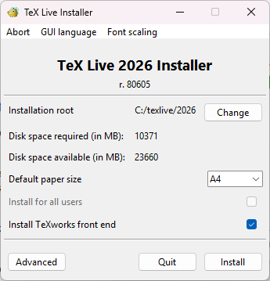
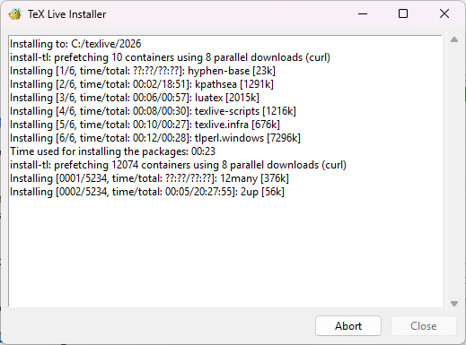

## Software Setup

This workshop will be demonstrated using [TeXStudio](https://www.texstudio.org/) to write and
render LaTeX documents. TeXStudio is a feature-rich, integrated LaTeX writing environment with
syntax highlighting, an integrated PDF viewer, and inline error checking. It is available for
Windows, macOS, and Linux.

Because TeXStudio is an **editor**, it needs a separate LaTeX **distribution** to compile documents.
The distribution provides the compilers and various packages which we will use throughout this
workshop.

::: caution

The distribution is quite large and can take quite a while to install! Please make sure to do this
ahead of the workshop!

:::

::: callout

It is not a requirement that you use TeXStudio - if you have an alternative IDE you would prefer,
that is perfectly fine!

:::

## Step 1: The Editor

We will be using TeXStudio for our demonstration.
Directions for this may vary based on your operating system.

::: tab

### Windows

1. [Download TeXStudio](https://texstudio.org/#download). Select the version appropriate for your
     operation system. You can use either the installer or the portable version - both will work
     similarly.
2. When you open the program, you should see a message warning that "No LaTeX Distribution can be found." That's ok! That's the next step.


### MacOS

!!!

### Linux

!!!

:::

## Step 2: The Distribution

1. [Download the Distribution from TexLive](https://tug.org/texlive/windows.html).
2. Run the installer. Ensure you have enough disk space to install all of the packages (The entire
     distribution is quite large - around 11GB). *It will take several hours to complete, so ensure that you do this well before the workshop*

{alt='The TexLive installer.'}

{alt='A Screenshot of the distribution being installed.'}

## Verify Installation

Open TeXStudio. You should see the main editor window with an empty document area.

Create a new file by selecting "File" > "New" (or pressing `Ctrl+N`) and paste the following
code into the editor. This document loads all of the packages used throughout the workshop, so
compiling it successfully confirms that your installation is complete.

```latex
\documentclass{article}
\usepackage{amsmath}                     % mathematics formatting
\usepackage{array}                       % extended table column types
\usepackage[ngerman,english]{babel}      % multilingual support
\usepackage[style=authoryear]{biblatex}  % bibliography management
\usepackage{booktabs}                    % professional table rules
\usepackage[autostyle]{csquotes}         % context-sensitive quotation
\usepackage{enumitem}                    % customisable lists
\usepackage[margin=1in]{geometry}        % page layout
\usepackage{graphicx}                    % including graphics
\usepackage{hyperref}                    % hyperlinks and cross-references
\usepackage{lipsum}                      % placeholder text
\usepackage{multirow}                    % multi-row table cells
\usepackage[parfill]{parskip}            % paragraph spacing
\usepackage{siunitx}                     % scientific units
\usepackage{tgtermes}                    % TeX Gyre Termes font
\usepackage{wrapfig}                     % text-wrapped figures
\usepackage[table]{xcolor}               % colour support

\begin{document}
Hello, \LaTeX!
\end{document}
```

Press **F5** (or select "Tools" > "Build & View") to compile the document. TeXStudio will run
the LaTeX compiler and, if successful, display the resulting PDF in the panel to the right of the
editor.

{alt="The TeXStudio editor with the Hello LaTeX code on the left and the compiled PDF showing 'Hello, LaTeX!' on the right"}

If you see the text "Hello, LaTeX!" in the PDF panel, your installation is working correctly.

### Troubleshooting

If you encounter an error during compilation like
"texstudio_iubQaA.tex: error: 6: File `biblatex.sty' not found. \usepackage`", this indicates that
you are missing some of the required LaTeX packages and will need to install them in your
distribution. This will depend on the distribution you chose earlier.

